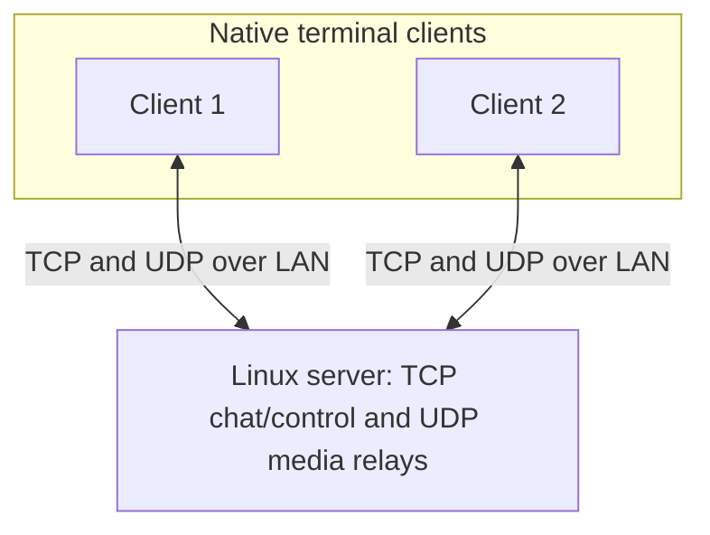

# Linux Communication Application

A **Linux-only C++20 client/server communication app** for local networks.
Users run native terminal clients connected to one server. Text and media
registration use TCP; voice, webcam video, and screen sharing use UDP relays.
Video viewing currently uses a separate receiver piped to `ffplay`.

## Current functionality

| Feature | Implementation and verification status |
| --- | --- |
| Text chat | Multi-client chat using `io_uring`, framed messages, input validation, and bounded outgoing queues; automated socket tests |
| Docker server | Five-client text scenario documented as verified; native clients connect to the container |
| Voice | Optional ALSA/Opus capture and playback, mute, and synthetic automated tests; local live checks documented, 3–5 client LAN acceptance pending |
| Webcam | V4L2/MJPEG sender and separate receiver; automated protocol/transport tests and documented local live checks |
| Screen sharing | Optional Wayland Portal/PipeWire capture and MJPEG encoding; synthetic tests and desktop capture checks documented in [Phase 7](docs/phases/PHASE_07.md) |
| Rooms and persistence | Planned; clients currently share one session |

The phase documents describe development history and acceptance results.
Those records do not replace running the tests on your current checkout.

## Architecture at a glance



## Stack

| Area | Choice |
| --- | --- |
| Language / platform | C++20 / Linux |
| Build | CMake |
| Server I/O | `io_uring` for TCP; socket-based UDP media relays |
| Media | Opus voice, V4L2/MJPEG webcam, optional Wayland Portal/PipeWire screen capture |
| Deployment | Native Linux server or Docker server; native Linux clients |
| Development / testing | TDD with focused tests for real behavior |

## Build, test, and run from a clean checkout

Requires Linux, CMake 3.20 or newer, Make, a C++20 compiler, and the liburing, Opus, and
JPEG development libraries. On Ubuntu/Debian, install the base dependencies:

```bash
sudo apt install build-essential cmake liburing-dev libopus-dev libjpeg-dev
```

Build from the source checkout on each destination machine. Generated build
directories and executables are local artifacts and should not be copied to
another machine. No VS Code installation or editor settings are required.
The automated-test workflow is defined in [CMakePresets.json](CMakePresets.json)
and requires CMake 3.25 or newer; see [Tests](tests/README.md).

This application currently targets Linux: the server requires a kernel and
execution environment permitting `io_uring`. Voice, webcam, and screen capture
use Linux-specific APIs and optional dependencies; Windows and macOS would
require platform implementations.

Run the following steps from the project root, in order:

1. **Configure:** generate the build files. This step does not compile programs.
2. **Build:** compile the server, client, and test executables. Tests are included
   in the default build when `BUILD_TESTING` is enabled (the default for a new
   build directory). No separate build of individual tests is needed.
3. **Test:** run the compiled test executables. CTest does not compile them.
4. **Launch:** start the server and clients in separate terminals after the
   build and automated tests succeed.

Stop if any step fails. In particular, do not run tests after a failed or
interrupted build. An existing build cache with `BUILD_TESTING` disabled must
have it enabled before building the tests. Building only the server or client
target does not build the test executables.

```bash
cmake -S . -B build
cmake --build build
ctest --test-dir build --output-on-failure

# Terminal 1
./build/communication_server

# Terminal 2
./build/communication_client 127.0.0.1 8080 Alice

# Terminal 3
./build/communication_client 127.0.0.1 8080 Bob
```

If CTest reports **Unable to find executable**, a required test binary has not
been built in that build directory. Check the preceding build output for the
first error; this is a test that could not run, not a failed assertion.

Use `/quit` in a client terminal to disconnect it. The server remains running
and reports the active connection count.

The server executable listens on TCP port `8080` on all IPv4 interfaces. Its
startup message currently labels the address as `127.0.0.1` even for this LAN
binding. Clients accept an IPv4 address, TCP port, and display name, in that
order; defaults are `127.0.0.1`, `8080`, and `Client`. Hostnames are not resolved.
Display names contain 1–32 letters, digits, underscores, or hyphens.

For LAN chat, replace `127.0.0.1` with the server's LAN IPv4 address and allow
TCP `8080` through its firewall. Media additionally uses separate audio and
video UDP ports selected at startup and printed by the server. This is a LAN
prototype: sender IDs are not cryptographic authentication, and the transports
do not provide encryption. See the phase documents for Docker and media setup.

## Build options

| Option | Default | Purpose |
| --- | --- | --- |
| `BUILD_TESTING` | `ON` | Build and register automated tests |
| `ENABLE_LIVE_AUDIO_CLIENT` | `OFF` | Enable `--voice`; requires ALSA development libraries |
| `ENABLE_LIVE_AUDIO_DEMO` | `OFF` | Build the manual microphone loopback executable |
| `ENABLE_WAYLAND_SCREEN_CAPTURE` | `OFF` | Enable `--screen-share`; requires pkg-config, libportal, and PipeWire development libraries |
| `ENABLE_PHASE4_CONTAINER_TEST` | `OFF` | Register tests against a separately running Docker server |

The default client supports text and webcam sending; it opens no camera unless
`--video` is supplied. The automated-test preset disables optional hardware
backends and container tests; it still tests media using synthetic data.

## Run the live voice client

Install the development libraries once, then configure a voice-enabled build:

```bash
sudo apt install libasound2-dev libopus-dev
cmake -S . -B build-voice -DENABLE_LIVE_AUDIO_CLIENT=ON -DBUILD_TESTING=OFF
cmake --build build-voice --target communication_server communication_client
```

Start the server in one terminal and two voice clients in two additional
terminals. Each client registers its UDP port over TCP, captures microphone
audio, and plays audio received from the other clients:

```bash
./build-voice/communication_server
./build-voice/communication_client 127.0.0.1 8080 Alice --voice
./build-voice/communication_client 127.0.0.1 8080 Bob --voice
```

For the integrated analog microphone/speaker on many laptops, the explicit
device form is often more reliable than `default`:

```bash
./build-voice/communication_client 127.0.0.1 8080 Alice --voice plughw:0,0 plughw:0,0
```

When running two voice clients on the same computer, `plughw` is exclusive.
Use ALSA's shared capture/playback plugins instead:

```bash
./build-voice/communication_client 127.0.0.1 8080 Alice --voice plug:dsnoop:0 plug:dmix:0
./build-voice/communication_client 127.0.0.1 8080 Bob --voice plug:dsnoop:0 plug:dmix:0
```

The two optional arguments immediately after `--voice` select the ALSA capture
and playback devices. Use `/mute` to stop or resume microphone transmission and
`/quit` to stop a client. Live voice is disabled in the default build, so
machines without ALSA hardware can still compile and run automated tests.

Pass `none` as the capture device to run a listener-only voice client. It does
not open or transmit microphone audio, but it still plays received audio.
Pass `none` as the playback device as well to run a completely silent client.

For the final LAN check, run the server on one machine, note its LAN address
and the UDP relay port printed at startup, then allow TCP `8080` and that UDP
port through its firewall. Run each client against the server's LAN address:

```bash
./build-voice/communication_client SERVER_LAN_IP 8080 Alice --voice default default
```

You can also run a three-client voice demonstration entirely on one host after
building the voice-enabled server and client. Stop any existing server on port
`8080` first: the launcher starts its own server and three local clients with one microphone-only sender,
one playback-only listener, and one muted client with microphone and playback
disabled to avoid acoustic feedback. Because only one client captures and one
client plays back, it uses the normal desktop `default` ALSA devices.

```bash
./tests/scripts/phase5_local_voice_demo.sh
```

Use headphones. To swap Alice and Bob, set both `ACTIVE_CLIENT=Bob` and
`LISTENER_CLIENT=Alice`; Carol remains the silent client. Press `Ctrl-C` to
cleanly stop all processes. This local demonstration does not complete the
pending multi-machine LAN voice acceptance.

## Webcam and screen sharing

Webcam sending is available with the default build:

```bash
./build/communication_client 127.0.0.1 8080 Alice --video /dev/video0
```

Run the server first. A second terminal can display the received stream using
the manual receiver and `ffplay` (provided by the FFmpeg package):

```bash
./build/phase6_video_receive_smoke 127.0.0.1 8080 Bob 0 --stdout-mjpeg \
  | ffplay -fflags nobuffer -f mjpeg -i -
```

The receiver's duration `0` runs until interrupted. The sending client does
not display incoming video. See [Phase 6](docs/phases/PHASE_06.md) for device
checks and combined voice/video usage.

Screen sharing requires the optional Wayland build and a running graphical
desktop session. Follow [Phase 7](docs/phases/PHASE_07.md) for dependencies,
build instructions, portal permission, and the receiver. The sender uses
`--screen-share`; webcam and screen sharing cannot be enabled together in one
client. Voice can be combined with either when both build options are enabled.

## Docker

The [Dockerfile](Dockerfile) builds the server; clients run natively. Follow
[Phase 4](docs/phases/PHASE_04.md) for the required `io_uring` seccomp profile
and container checks. Its TCP port mapping covers text chat. Media also needs
UDP networking for the dynamically selected relay ports; the Phase 4 container
instructions do not establish a voice/video deployment.

## Documentation

- [Project roadmap](docs/PLAN.md) — development stages, scope, and future work
- [Test suite guide](tests/README.md) — automated tests, shared helpers, and result reporting
- [Testing and acceptance plan](docs/TEST_PLAN.md) — behavior coverage and manual device/LAN checks

The phase guides record implementation steps and acceptance results. Their
status distinguishes implemented features from work still awaiting acceptance
or planned for later.

| Guide | Covers | Status |
| --- | --- | --- |
| [Phase 1 — Basic connections](docs/phases/PHASE_01.md) | Client connections and disconnects | Implemented |
| [Phase 2 — `io_uring` server](docs/phases/PHASE_02.md) | Asynchronous TCP I/O and operation lifetimes | Implemented |
| [Phase 3 — Text chat](docs/phases/PHASE_03.md) | Framing, validation, message delivery, and ordering | Implemented |
| [Phase 4 — LAN text chat](docs/phases/PHASE_04.md) | Docker server and five-client checks | Implemented; acceptance documented |
| [Phase 5 — Group voice](docs/phases/PHASE_05.md) | ALSA/Opus audio, mute, and UDP relay | Implemented; 3–5 client LAN acceptance pending |
| [Phase 6 — Webcam video](docs/phases/PHASE_06.md) | V4L2/MJPEG capture, relay, and separate viewer | Implemented; local live checks documented |
| [Phase 7 — Screen sharing](docs/phases/PHASE_07.md) | Wayland Portal/PipeWire capture and screen streaming | Implemented; desktop capture checks documented |
| [Phase 8 — Multiple rooms](docs/phases/PHASE_08.md) | Room membership and communication isolation | Planned |
| [Phase 9 — SQLite persistence](docs/phases/PHASE_09.md) | Optional persistent storage | Planned; optional |

## Development status

- [x] Phase 1 — One client, then two clients, connect to a local TCP server
- [x] Phase 2 — Replace blocking server I/O with `io_uring`
- [x] Phase 3 — Two-client text chat with framing, validation, ordering, and cleanup
- [x] Phase 4 — Dockerized LAN text chat with five native clients
- [ ] Phase 5 — Group voice (local two-client ALSA/Opus demo verified with mute; 3–5 client LAN acceptance pending)
- [x] Phase 6 — Webcam video (V4L2/MJPEG capture, authorized UDP relay, live viewer, and voice/text coexistence verified locally with headphones)
- [x] Phase 7 — Wayland screen sharing (implemented; synthetic tests and desktop capture results documented in the phase guide)
- [ ] Phase 8 — Multiple rooms
- [ ] Phase 9 — Optional SQLite persistence

**Workflow:** use TDD for each behavior: write a meaningful failing test,
implement the minimum to pass, then refactor. The roadmap describes planned
later phases, not completed work.
