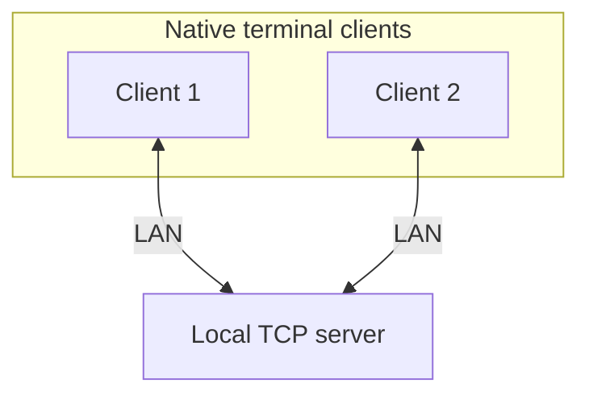

# Linux Communication Application

A **Linux-only C++20 communication app**. Start by connecting one client, then two; next introduce server-side `io_uring`, then build chat and grow toward the multi-client LAN app with voice, video, screen sharing, and multiple rooms.

> **Current state:** Repository bootstrap only. The server and client executables print a startup message and exit. No networking, rooms, media, or automated tests are implemented yet.

## First phases

Build up the network foundation in small, testable steps:

1. Start a basic local TCP server and connect one client.
2. Connect two clients at the same time; verify disconnect behavior.
3. Replace the server's blocking I/O with `io_uring`.
4. Add text chat between the connected clients.

TDD applies to each phase. Docker deployment and five-client LAN testing follow
the working two-client chat; voice, video, screen sharing, multiple rooms, and
optional persistence remain later steps.

## Architecture at a glance



*First-phase target, not current functionality.*

## Stack

| Area | Choice |
| --- | --- |
| Language / platform | C++20 / Linux |
| Build | CMake |
| Initial server I/O | TCP sockets; `io_uring` in Phase 2 |
| Deployment | Local processes first; Docker planned after the local flow works |
| Development / testing | TDD with focused tests for real behavior |

## Build the current starter

Requires Linux, CMake, and a C++20 compiler.

```bash
cmake -S . -B build
cmake --build build
./build/communication_server
./build/communication_client
```

The programs are **bootstraps**, not a functional TCP server or client. The
first phase below is the next implementation target.

## Documentation

- [Project plan](docs/PLAN.md) — first phase and longer-term roadmap
- [Testing plan](docs/TEST_PLAN.md) — focused checks for implemented behavior
- [Phase 1 — Basic connections](docs/phases/PHASE_01.md) — one client, then two
- [Phase 2 — `io_uring` server](docs/phases/PHASE_02.md)
- [Phase 3 — Text chat](docs/phases/PHASE_03.md)
- [Phase 4 — LAN text chat](docs/phases/PHASE_04.md) — Docker and five clients
- [Phase 5 — Group voice](docs/phases/PHASE_05.md)
- [Phase 6 — Webcam video](docs/phases/PHASE_06.md)
- [Phase 7 — Screen sharing](docs/phases/PHASE_07.md)
- [Phase 8 — Multiple rooms](docs/phases/PHASE_08.md)
- [Phase 9 — SQLite persistence](docs/phases/PHASE_09.md) — optional

## Development status

- [ ] Phase 1 — One client, then two clients, connect to a local TCP server

**Workflow:** use TDD for each behavior: write a meaningful failing test,
implement the minimum to pass, then refactor. The roadmap describes planned
later phases, not completed work.
