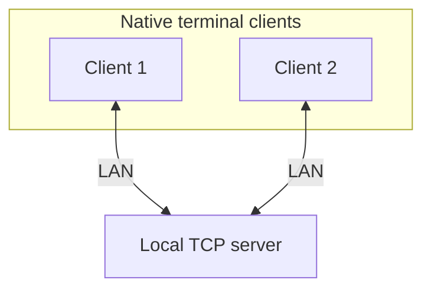

# Linux Communication Application

A **Linux-only C++20 communication app**. Start by connecting one client, then two; next introduce server-side `io_uring`, then build chat and grow toward the multi-client LAN app with voice, video, screen sharing, and multiple rooms.

> **Current state:** Phases 1–4 are implemented and tested. The server supports concurrent local clients and five native clients connecting to a Dockerized server.

## First phases

Build up the network foundation in small, testable steps:

1. Start a basic local TCP server and connect one client.
2. Connect two clients at the same time; verify disconnect behavior.
3. Replace the server's blocking I/O with `io_uring`.
4. Add text chat between the connected clients.

TDD applies to each phase. Docker deployment and five-client LAN testing follow
the working two-client chat; voice, video, screen sharing, multiple rooms, and
optional persistence remain later steps.

## Architecture at a glance



*First-phase target, not current functionality.*

## Stack

| Area | Choice |
| --- | --- |
| Language / platform | C++20 / Linux |
| Build | CMake |
| Initial server I/O | TCP sockets; `io_uring` in Phase 2 |
| Deployment | Local processes first; Docker planned after the local flow works |
| Development / testing | TDD with focused tests for real behavior |

## Build and run Phase 1

Requires Linux, CMake, and a C++20 compiler.

```bash
cmake -S . -B build
cmake --build build
ctest --test-dir build --output-on-failure

# Terminal 1
./build/communication_server

# Terminals 2 and 3
./build/communication_client
./build/communication_client
```

Press Enter in either client terminal to disconnect it. The server remains
running and reports the active connection count.

## Run the live voice client

Install the development libraries once, then configure a voice-enabled build:

```bash
sudo apt install libasound2-dev libopus-dev
cmake -S . -B build-voice -DENABLE_LIVE_AUDIO_CLIENT=ON -DBUILD_TESTING=OFF
cmake --build build-voice --target communication_server communication_client
```

Start the server in one terminal and two voice clients in two additional
terminals. Each client registers its UDP port over TCP, captures microphone
audio, and plays audio received from the other clients:

```bash
./build-voice/communication_server
./build-voice/communication_client 127.0.0.1 8080 Alice --voice
./build-voice/communication_client 127.0.0.1 8080 Bob --voice
```

For the integrated analog microphone/speaker on many laptops, the explicit
device form is often more reliable than `default`:

```bash
./build-voice/communication_client 127.0.0.1 8080 Alice --voice plughw:0,0 plughw:0,0
```

When running two voice clients on the same computer, `plughw` is exclusive.
Use ALSA's shared capture/playback plugins instead:

```bash
./build-voice/communication_client 127.0.0.1 8080 Alice --voice plug:dsnoop:0 plug:dmix:0
./build-voice/communication_client 127.0.0.1 8080 Bob --voice plug:dsnoop:0 plug:dmix:0
```

The optional fifth and sixth arguments select the ALSA capture and playback
devices. Use `/mute` to stop or resume microphone transmission and `/quit` to
stop a client. The normal `build` remains text-only so CI and machines without
ALSA hardware can still compile the application.

For the final LAN check, run the server on one machine, note its LAN address
and the UDP relay port printed at startup, then allow TCP `8080` and that UDP
port through its firewall. Run each client against the server's LAN address:

```bash
./build-voice/communication_client SERVER_LAN_IP 8080 Alice --voice default default
```

## Documentation

- [Project plan](docs/PLAN.md) — first phase and longer-term roadmap
- [Testing plan](docs/TEST_PLAN.md) — focused checks for implemented behavior
- [Phase 1 — Basic connections](docs/phases/PHASE_01.md) — one client, then two
- [Phase 2 — `io_uring` server](docs/phases/PHASE_02.md)
- [Phase 3 — Text chat](docs/phases/PHASE_03.md)
- [Phase 4 — LAN text chat](docs/phases/PHASE_04.md) — Docker and five clients
- [Phase 5 — Group voice](docs/phases/PHASE_05.md)
- [Phase 6 — Webcam video](docs/phases/PHASE_06.md)
- [Phase 7 — Screen sharing](docs/phases/PHASE_07.md)
- [Phase 8 — Multiple rooms](docs/phases/PHASE_08.md)
- [Phase 9 — SQLite persistence](docs/phases/PHASE_09.md) — optional

## Development status

- [x] Phase 1 — One client, then two clients, connect to a local TCP server
- [x] Phase 2 — Replace blocking server I/O with `io_uring`
- [x] Phase 3 — Two-client text chat with framing, validation, ordering, and cleanup
- [x] Phase 4 — Dockerized LAN text chat with five native clients
- [ ] Phase 5 — Group voice (local two-client ALSA/Opus demo verified with mute; 3–5 client LAN acceptance pending)

**Workflow:** use TDD for each behavior: write a meaningful failing test,
implement the minimum to pass, then refactor. The roadmap describes planned
later phases, not completed work.
