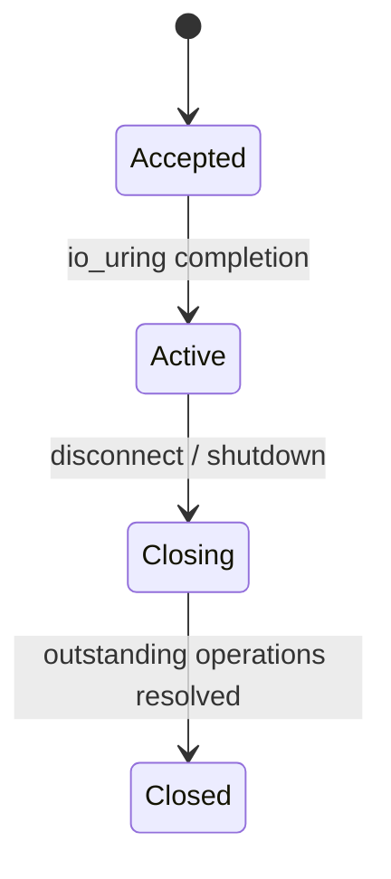

# Phase 2 — `io_uring` Server

**Version:** 0.2 · **Status:** Complete · **Prerequisite:** Phase 1

[Roadmap](../PLAN.md) · [Testing strategy](../TEST_PLAN.md) · [README](../../README.md)

## Goal

Replace the simple blocking server I/O from Phase 1 with a Linux `io_uring`
event loop, preserving reliable one- and two-client connection behavior.

**In scope:** `io_uring` setup, asynchronous accept/receive/send, operation and
buffer lifetimes, disconnect/shutdown cleanup, and real-socket tests.
**Out of scope:** chat messages, rooms, Docker deployment, and media.

## Connection lifecycle



Keep every operation's state and buffers valid until its completion is
processed. Start with one event-loop thread and basic one-shot operations.

## Build in this order (Red → Green → Refactor)

| Step | Behavior / implementation | New test first |
| --- | --- | --- |
| 2.1 | Initialize and shut down the `io_uring` instance | Setup success, initialization failure, and cleanup |
| 2.2 | Accept one client asynchronously | Real client connection and accept error |
| 2.3 | Receive and send data asynchronously | Real-socket round trip, EOF, and partial I/O |
| 2.4 | Support two concurrent connections | Both clients connect and remain active |
| 2.5 | Handle disconnect and server shutdown safely | Disconnect during I/O and clean process exit |

## File ownership

| Area | Location |
| --- | --- |
| `io_uring` and connection handling | `server/include/`, `server/src/` |
| Client connection behavior | `client/include/`, `client/src/` |
| Real-socket connection tests | `tests/integration/` |

Create files and abstractions only as needed. Retain the Phase 1 connection
tests as regression coverage.

## Completion criteria

- `io_uring` is used for server network I/O.
- One and two real clients can connect and disconnect cleanly.
- Outstanding operations and buffers are cleaned up safely during shutdown.
- Phase 1 and Phase 2 active tests pass.

## Dependency

Install the Linux `liburing` development package before configuring the
project:

```bash
sudo apt update
sudo apt install liburing-dev
```

The project CMake configuration detects `liburing.h` and links the `uring`
library for the server and integration tests.
