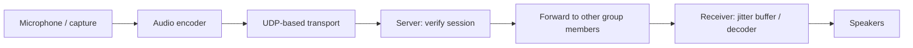

# Phase 5 — Group Voice

**Version:** 0.5 · **Status:** In Progress · **Prerequisite:** Phase 4 (LAN Text Chat) · **MVP milestone**

[Roadmap](../PLAN.md) · [Testing strategy](../TEST_PLAN.md) · [README](../../README.md)

## Goal

Three to five LAN users can speak and listen simultaneously in the shared chat group with usable real-time voice quality.

**In scope:** capture/playback, codec, UDP-based transport, sender-to-session association, server forwarding, multiple streams, mute, jitter and packet-loss handling. **Out of scope:** webcam video, screen sharing, internet NAT traversal unless LAN tests demonstrate a need.

## Target media flow



*Media transport and codec choices are intentionally deferred to this phase.*

## Build in this order (Red → Green → Refactor)

| Step | Behavior / implementation | New test first |
| --- | --- | --- |
| 5.1 | Choose audio API, codec, packet format, and latency target | Document compatibility and codec round-trip acceptance |
| 5.2 | Capture and encode local microphone audio | Synthetic samples encode/decode; manual device check |
| 5.3 | Add UDP I/O and authenticate/associate media session | Reject unassociated or unauthorized media packets |
| 5.4 | Forward packets to group participants | Fake recipient set excludes sender/nonmembers |
| 5.5 | Receive/play multiple independent audio streams | Deterministic fake-source tests |
| 5.6 | Implement mute and basic jitter/loss tolerance | Mute, reorder, loss, and stream stop tests |
| 5.7 | Verify real voice end to end | Three-to-five-person LAN listening/latency check |

## Initial media contract

The first implementation targets Opus-encoded, mono voice frames at 48 kHz
with a 20 ms audio duration and a 32 kbps target bitrate. The server forwards
encoded frames and does not mix them. Media uses UDP because occasional packet loss is preferable to
blocking later audio behind an old packet.

Each packet will use a small versioned header containing:

- protocol magic and version;
- session identifier;
- sender identifier;
- monotonically increasing sequence number; and
- encoded payload length followed by the Opus payload.

The complete packet is limited to 1,200 bytes so it remains below the usual
Ethernet path-MTU budget. The packet serializer/deserializer is tested before
adding capture devices, codecs, or network sockets.

The codec test requires the Opus development package on the host:

```bash
sudo apt update
sudo apt install libopus-dev
```

The Docker builder installs the equivalent `libopus-dev` package and the
runtime image carries `libopus0`.

### Manual real-device audio check

The synthetic codec test is automated; it does not prove that Linux can open
the selected microphone and speaker. Build the optional ALSA loopback after
installing the ALSA development package:

```bash
sudo apt install libasound2-dev
cmake -S . -B build -DENABLE_LIVE_AUDIO_DEMO=ON
cmake --build build --target live_audio_loopback
./build/live_audio_loopback
```

This gives the audible path `microphone -> Opus encode/decode -> speaker`.
Press `Ctrl-C` to stop. It is intentionally a manual check rather than a
CTest test because build agents often have no physical audio devices. The
actual network voice check remains step 5.7.

### Phase 5.3 progress

Before accepting a UDP media datagram, the server-side media layer must verify
that its session and sender are associated. `AudioSessionRegistry` now covers
that first security behavior: unregistered sessions, wrong senders, and
revoked senders are rejected by
`tests/unit/phase5_audio_session_test.cpp`. The real UDP receive path is now
covered by `tests/integration/phase5_udp_transport_test.cpp`: it rejects an
unassociated datagram and accepts a datagram after its sender is registered.
Forwarding packets to other participants is the next Phase 5.4 behavior.

## File ownership

| Area | Location |
| --- | --- |
| Media packet definitions | `common/` |
| UDP media transport and forwarding | `server/` |
| Capture, codec, playback, jitter buffer | `client/` |
| Synthetic audio/fake devices | `tests/mocks/`, `tests/unit/` |
| Real multi-client network checks | `tests/integration/`, `tests/scripts/` |

For the initial server, forward encoded streams rather than mixing audio on the server unless measurements show that mixing is necessary.

## Completion criteria — initial MVP

- Three to five users can speak and hear other participants simultaneously.
- Muting stops microphone transmission.
- Loss/disconnects do not crash the server or clients.
- Only valid group participants receive voice packets.
- Automated audio/transport tests pass; physical audio devices are checked manually.
- All earlier regression tests remain green.
