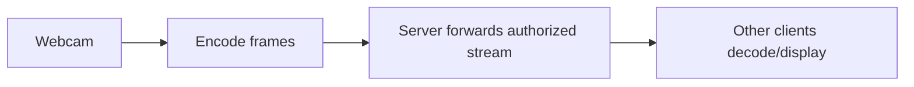

# Phase 6 — Webcam Video

**Version:** 0.6 · **Status:** In Progress · **Prerequisite:** Phase 5

[Roadmap](../PLAN.md) · [Testing strategy](../TEST_PLAN.md) · [README](../../README.md)

## Audio environment note

The Phase 5 live voice check works in the current local setup, but the
microphone environment has noticeable background noise and occasional buzzing.
Treat that as an environment/audio-device limitation for now, not as proof that
the network voice path is failing. Use headphones, keep microphone boost low,
and disable ALSA loopback while testing Phase 6 video so audio feedback does
not obscure video results. Later audio-quality work should consider noise
suppression, echo cancellation, and microphone-level controls.

## Goal

Multiple LAN participants can share webcam video while maintaining text and
voice communication.

**In scope:** camera start/stop, capture, encode/decode, low-latency transport,
multi-stream display, and basic resolution/network adaptation. **Out of
scope:** advanced conferencing UI and recording.

## Planned flow

### Phase 6.1 progress

The first TDD increment defines a versioned `VideoFrame` envelope with session,
sender, sequence, dimensions, and encoded payload fields. Its unit test covers
round-trip serialization, invalid headers, truncation, zero dimensions, and the
maximum frame size. Webcam capture and codec selection remain separate steps;
this protocol layer is intentionally hardware-independent.

The initial Linux implementation will use V4L2 (`/dev/video*`) for webcam
discovery and capture. The first real capture format will be camera-provided
MJPEG, because it avoids adding a software encoder before device lifecycle and
transport behavior are proven. The encoded MJPEG bytes fit the `VideoFrame`
payload; decoding and display will be added after capture works. A later step
can introduce a software codec when measurements show that camera MJPEG is not
available or efficient enough.

The capture lifecycle test now verifies that an unavailable V4L2 device fails
cleanly, remains stopped, rejects frame reads, and can be stopped repeatedly.
The real-device path is intentionally not registered as a normal CTest because
CI machines may not contain `/dev/video*` hardware.

The next TDD increment validates camera-provided MJPEG boundaries before a
payload is wrapped in a `VideoFrame`. It requires the JPEG start/end markers,
rejects empty or oversized data, and rejects invalid dimensions. This keeps
bad camera data out of the transport layer without requiring a physical camera
or software decoder in automated tests.

The capture wrapper now exposes `readVideoFrame(...)`, which combines one
V4L2 capture read with MJPEG validation and the `VideoFrame` metadata. A
failed capture or invalid payload produces no frame, so callers do not have
to forward unchecked camera bytes.

## Build in this order (Red → Green → Refactor)

| Step | Behavior / implementation | New test first |
| --- | --- | --- |
| 6.1 | Choose capture/codec/render APIs and frame format | Synthetic frame round-trip acceptance |
| 6.2 | Webcam capture and enable/disable states | Fake capture lifecycle tests; manual device check |
| 6.3 | Encode and decode frames | Repeatable synthetic sample tests |
| 6.4 | Forward frames to authorized members | Mock forwarding / membership tests |
| 6.5 | Receive and display multiple streams | Fake multi-stream rendering/lifecycle tests |
| 6.6 | Respond to changing resolution/network conditions | Stream restart, slow receiver, and size-limit tests |
| 6.7 | Run LAN video + voice integration | Real clients and webcams, earlier tests green |

## Completion criteria

- Multiple participants can share webcam video while voice and text continue.
- Stream start/stop and slow receivers are handled without unbounded resource
  use.
- Synthetic-frame tests pass; real webcam behavior is checked manually.
- Earlier phase tests remain green.
