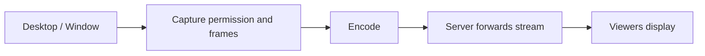

# Phase 7 — Screen Sharing

**Version:** 0.7 · **Status:** In Progress · **Prerequisite:** Phase 6

[Roadmap](../PLAN.md) · [Testing strategy](../TEST_PLAN.md) · [README](../../README.md)

## Goal

A user shares their desktop or a supported application window with others while voice/text remain usable.

Linux desktop capture APIs differ by display system. Choose the actual supported environment (for example, Wayland with portal/PipeWire support or X11) when entering this phase.

### Phase 7.1 decision

The development environment is Ubuntu GNOME on Wayland. The supported target
for this phase is therefore Wayland through the XDG Desktop Portal and
PipeWire. Portal capture provides the user permission dialog and supports both
full-desktop and application-window selection; direct X11 capture is not the
primary path for this session.

Before adding portal code, the client defines a hardware-independent
`ScreenCaptureSource` contract. It owns start/stop state and returns the same
`VideoFrame` metadata shape used by webcam capture. The unit test uses a fake
source to prove that frames are unavailable before start and after stop, and
that a running source can return session and sequence metadata.

## Planned flow

## Build in this order (Red → Green → Refactor)

| Step | Behavior / implementation | New test first |
| --- | --- | --- |
| 7.1 | Select capture API and supported Linux session types | Document target environment and fake-capture contract |
| 7.2 | Implement start/stop and capture lifecycle | Fake capture state tests |
| 7.3 | Encode and transmit captured frames | Synthetic image/frame round-trip tests |
| 7.4 | Forward screen stream to authorized members | Mock routing and isolation tests |
| 7.5 | View shared content alongside voice | Multi-viewer integration and stream stop tests |
| 7.6 | Validate on a real Linux desktop | Manual permission/capture and stability tests |

## File ownership

| Area | Location |
| --- | --- |
| Screen-share packet/control types | `common/` |
| Screen-stream forwarding | `server/` |
| Linux capture and viewing | `client/` |
| Synthetic frames/fake capture | `tests/mocks/`, `tests/unit/` |
| Real multi-viewer integration | `tests/integration/` |

## Completion criteria

- A selected desktop/window can be shared on the supported Linux environment.
- Other authorized participants can view it while voice continues.
- Start, stop, permission denial, and disconnection are handled cleanly.
- Synthetic-frame tests and manual desktop capture verification pass.
