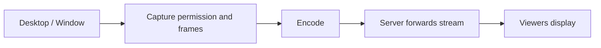

# Phase 7 — Screen Sharing

**Version:** 0.7 · **Status:** Complete · **Prerequisite:** Phase 6

[Roadmap](../PLAN.md) · [Testing strategy](../TEST_PLAN.md) · [README](../../README.md)

## Goal

A user shares their desktop or a supported application window with others while voice/text remain usable.

Linux desktop capture APIs differ by display system. Choose the actual supported environment (for example, Wayland with portal/PipeWire support or X11) when entering this phase.

### Phase 7.1 decision

The development environment is Ubuntu GNOME on Wayland. The supported target
for this phase is therefore Wayland through the XDG Desktop Portal and
PipeWire. Portal capture provides the user permission dialog and supports both
full-desktop and application-window selection; direct X11 capture is not the
primary path for this session.

Before adding portal code, the client defines a hardware-independent
`ScreenCaptureSource` contract. It owns start/stop state and returns the same
`VideoFrame` metadata shape used by webcam capture. The unit test uses a fake
source to prove that frames are unavailable before start and after stop, and
that a running source can return session and sequence metadata.

### Phase 7.2 prerequisite

The real backend requires the PipeWire and Portal development interfaces. They
are installed on the development machine with:

```bash
sudo apt install libpipewire-0.3-dev libportal-dev
```

The runtime `pipewire` command alone is not sufficient to compile the client;
the headers and link libraries are needed for Portal/PipeWire stream setup.
The installed versions can be checked with:

```bash
pkg-config --modversion libpipewire-0.3 libportal libspa-0.2
```

### Phase 7.3 — raw screen frames to MJPEG

PipeWire supplies raw BGRA screen frames, while the existing video transport
uses MJPEG. Install the JPEG development package before implementing the
encoder and its tests:

```bash
sudo apt install libjpeg-dev
```

The encoder is implemented in `common/src/screen_frame_encoder.cpp` and is
covered by `phase7_screen_frame_encoder_test`. It validates dimensions, stride,
pixel-buffer size, and quality, converts BGRA rows to RGB, and produces a
payload accepted by the existing MJPEG/video-frame protocol.

The real session backend is now available as an opt-in build target. Configure
it with:

```bash
cmake -S . -B build-wayland \
  -DENABLE_WAYLAND_SCREEN_CAPTURE=ON \
  -DBUILD_TESTING=OFF
cmake --build build-wayland --target phase7_portal_capture_smoke
./build-wayland/phase7_portal_capture_smoke
```

This opens the desktop/window permission dialog, starts the Portal session,
opens its PipeWire remote, negotiates a raw video stream, waits for one real
frame, encodes it as MJPEG, and closes it cleanly. The test must be run from
an active graphical Wayland session and the permission dialog must be
accepted.

The Portal/PipeWire session lifecycle and frame delivery have been verified on
the development Wayland session. The smoke test opened the permission dialog,
received a real `1920x1080` frame, encoded it as MJPEG, and stopped the
session cleanly. The backend resolves the screen node through the private
PipeWire registry, negotiates mapped memory buffers, and supports the portal's
legacy stream response when `pipewire-serial` is not included.

Large desktop JPEGs are fragmented into UDP-sized datagrams and reassembled
by the server and receiving client. This is required because a full-screen
`1920x1080` MJPEG frame is larger than the maximum safe UDP datagram, even
though ordinary webcam frames may fit in one packet.

## Planned flow



## Build in this order (Red → Green → Refactor)

| Step | Behavior / implementation | New test first |
| --- | --- | --- |
| 7.1 | Select capture API and supported Linux session types | Document target environment and fake-capture contract |
| 7.2 | Implement start/stop and capture lifecycle | Fake capture state tests |
| 7.3 | Encode captured BGRA frames as MJPEG | `tests/unit/phase7_screen_frame_encoder_test.cpp` |
| 7.4 | Forward screen stream to authorized members | Screen-video client lifecycle and existing video relay |
| 7.5 | View shared content alongside voice | `tests/integration/phase7_screen_share_integration_test.cpp` |
| 7.6 | Validate on a real Linux desktop | Manual permission/capture and stability tests |

## File ownership

| Area | Location |
| --- | --- |
| Screen-share packet/control types | `common/` |
| Screen-stream forwarding | `server/` |
| Linux capture and viewing | `client/` |
| Synthetic frames/fake capture | `tests/mocks/`, `tests/unit/` |
| Real multi-viewer integration | `tests/integration/` |

## Run the screen-share client

Build the optional Wayland client and server support:

```bash
cmake -S . -B build-wayland \
  -DENABLE_WAYLAND_SCREEN_CAPTURE=ON \
  -DBUILD_TESTING=OFF
cmake --build build-wayland --target communication_server communication_client
```

Start the server, then start a client with:

```bash
./build-wayland/communication_client 127.0.0.1 8080 Alice --screen-share
```

The client registers as a normal `VIDEO_PORT` participant. The server’s
existing authorized-member relay forwards the encoded screen frames to video
viewers, so screen sharing and webcam video use the same transport and access
rules.

For a receiving client, use the existing video viewer:

```bash
./build-wayland/phase6_video_receive_smoke 127.0.0.1 8080 Bob 10
```

For a visible local demonstration, pipe the receiving client's MJPEG output
to `ffplay`:

```bash
./build-wayland/phase6_video_receive_smoke \
  127.0.0.1 8080 Bob 0 --stdout-mjpeg \
  | ffplay -fflags nobuffer -f mjpeg -i -
```

Then run the sender in another terminal:

```bash
./build-wayland/communication_client 127.0.0.1 8080 Alice --screen-share
```

The Phase 7 integration test verifies that an encoded screen frame reaches an
authorized viewer and that frames stop being forwarded after the sender’s TCP
connection closes.

## Completion criteria

- [x] A selected desktop/window can be shared on the supported Linux environment.
- [x] Other authorized participants can view it while voice continues.
- [x] Start, stop, permission denial, and disconnection are handled cleanly.
- [x] Synthetic-frame tests and manual desktop capture verification pass.
