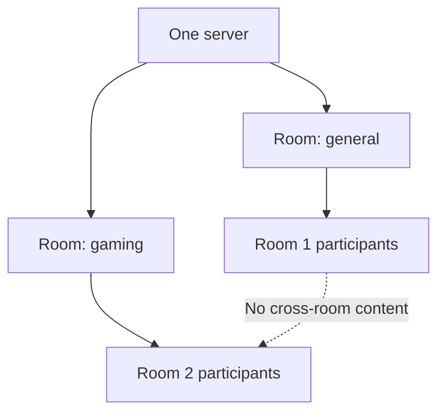

# Phase 8 — Multiple Rooms

**Version:** 0.8 · **Status:** Planned · **Prerequisite:** Phase 7

[Roadmap](../PLAN.md) · [Testing strategy](../TEST_PLAN.md) · [README](../../README.md)

## Goal

Support multiple independent rooms in the same server process, with correct membership and separation of text and multimedia traffic.

**In scope:** create, join, leave, switch, room-scoped participant lists, authorized routing and cleanup. **Out of scope:** complex roles, public discovery, separate containers per room.

## Planned layout

## Build in this order (Red → Green → Refactor)

| Step | Behavior / implementation | New test first |
| --- | --- | --- |
| 8.1 | Add room creation and stable IDs | Create/duplicate/invalid room unit tests |
| 8.2 | Add manual join/leave and room participant views | Correct membership + notification tests |
| 8.3 | Implement switching rooms in client/server | Atomic leave/join behavior and state update tests |
| 8.4 | Scope all text broadcasts to membership | Cross-room negative delivery tests |
| 8.5 | Scope audio/video/screen forwarding to membership | Cross-room media isolation tests |
| 8.6 | Run multiple concurrent rooms in five-client harness | Five-client cross-room integration regression |

## File ownership

| Area | Location |
| --- | --- |
| Room commands and events | `common/` |
| RoomManager, membership, media authorization | `server/` |
| Room list and switch controls | `client/` |
| Room and isolation tests | `tests/unit/`, `tests/integration/` |

Add room management to the existing server; do not create a new server per room.

## Completion criteria

- Clients can create and switch rooms, and see correct participants.
- Text, voice, webcam, and screens are not delivered across room boundaries.
- Abrupt disconnects remove clients from every relevant membership.
- Two or more rooms work concurrently in the same container.
- All earlier regression tests pass.
