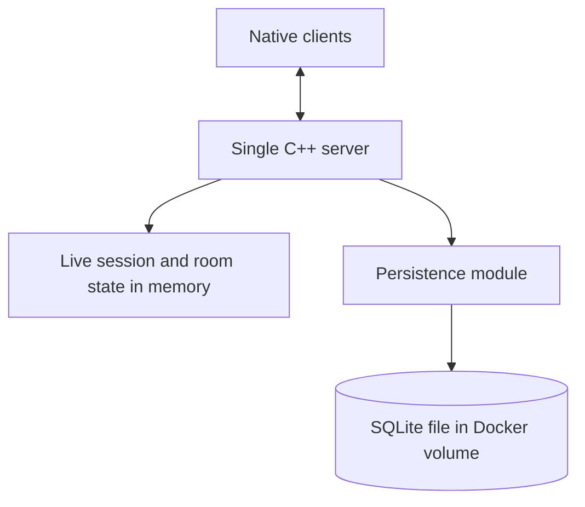

# Phase 9 — SQLite Persistence (Optional)

**Version:** 0.9 · **Status:** Optional / planned · **Prerequisite:** Functional live app

[Roadmap](../PLAN.md) · [Testing strategy](../TEST_PLAN.md) · [README](../../README.md)

## Goal

Persist selected application data across server/container restarts without introducing an additional database service.

**SQLite is optional.** Add this phase only when you want retained message history, saved rooms, or durable user accounts. Do not store live sockets, media packets, or active session membership in the database.

## Planned architecture

## Build in this order (Red → Green → Refactor)

| Step | Behavior / implementation | New test first |
| --- | --- | --- |
| 9.1 | Define what data must survive restarts | Written durability and retention acceptance cases |
| 9.2 | Introduce a small persistence interface and SQLite adapter | Fake repository and temporary SQLite CRUD tests |
| 9.3 | Store/retrieve text message history (if wanted) | Ordering, limits and restart persistence tests |
| 9.4 | Persist room definitions (if wanted) | Restart restores saved room metadata |
| 9.5 | Persist accounts/preferences (if wanted) | Validation and lifecycle tests; authentication design separately |
| 9.6 | Add schema migrations and Docker volume | Upgrade, rollback/failure and container-recreation tests |

## File ownership

| Area | Location |
| --- | --- |
| Persistence API and SQLite implementation | `server/include/`, `server/src/`; create `server/persistence/` if it grows |
| Shared persistent DTOs only if truly needed | `common/` |
| Temporary SQLite fixtures and fake storage | `tests/unit/`, `tests/mocks/` |
| Container restart/volume checks | `tests/integration/`, `tests/scripts/` |
| Database file | Docker named volume or host-mounted data directory; not committed |

## Test rules

- Unit/integration database tests use disposable temporary files, not real project data.
- Test transactions, schema changes, corrupt inputs, restart behavior, and failed writes.
- Keep network/media logic functional without persistence when the optional feature is disabled.

## Completion criteria

- Selected data survives restarting/recreating the Docker container with the persisted volume.
- Tests verify behavior through the real SQLite adapter, not only a fake repository.
- Live communication still works and previously completed tests stay green.
